<div align="center">


# Laravel Lab

**Aplicación web de laboratorio · Autenticación y patrón MVC**

| | |
|---|---|
| **Framework** | Laravel 13.36 |
| **Autenticación** | Laravel UI 4 |
| **Base de datos** | SQLite de ejemplo; MySQL configurable |
| **Repositorio** | [hlemerix/laravel-lab](https://github.com/hlemerix/laravel-lab) |

</div>

---

## 📑 Índice

1. [Tecnologías utilizadas](#1--tecnologías-utilizadas)
2. [Introducción y objetivo](#2--introducción-y-objetivo)
3. [Requisitos previos](#3--requisitos-previos)
4. [Resultado visible del proyecto](#4--resultado-visible-del-proyecto)
5. [Instalación y ejecución](#5--instalación-y-ejecución)
6. [Base de datos](#6--base-de-datos)
7. [Funcionalidades y controles](#7--funcionalidades-y-controles)
8. [Estructura del proyecto y MVC](#8--estructura-del-proyecto-y-mvc)
9. [Evidencias de migraciones y registros](#9--evidencias-de-migraciones-y-registros)
10. [Dificultades y soluciones](#10--dificultades-y-soluciones)
11. [Referencias](#11--referencias)
12. [Fecha de ejecución e información del estudiante](#12--fecha-de-ejecución-e-información-del-estudiante)

---

## 1. 🧰 Tecnologías utilizadas

| Tecnología | Uso en el proyecto |
|---|---|
| **PHP 8.3 o superior** | Lenguaje de programación del backend |
| **Laravel Framework 13.36** | Framework de la aplicación web |
| **Laravel UI 4.6** | Vistas y rutas de autenticación |
| **Blade** | Plantillas para las páginas de la aplicación |
| **Bootstrap 5** | Estilos de los formularios y componentes |
| **SQLite** | Base de datos de ejemplo configurada en `.env.example` |
| **MySQL** | Alternativa de base de datos configurable |
| **Composer** | Instalación y gestión de dependencias PHP |
| **Node.js, npm y Vite** | Instalación y compilación de recursos frontend |
| **WampServer y phpMyAdmin** | Entorno local utilizado para ejecutar y administrar la aplicación |
| **Git y GitHub** | Control de versiones y publicación del proyecto |

---

## 2. 📘 Introducción y objetivo

### Descripción

**Laravel Lab** es una aplicación web desarrollada con Laravel. Incluye las páginas de registro e inicio de sesión, recuperación de contraseña y un panel protegido para usuarios autenticados. El proyecto también contiene la estructura inicial de un módulo de productos y su migración de base de datos.

La aplicación permite practicar el flujo **Modelo–Vista–Controlador (MVC)**, el enrutamiento, la autenticación, las vistas Blade y las migraciones de Laravel.

### Objetivos

- Reconocer las capas principales de una aplicación Laravel y cómo se relacionan.
- Usar el sistema de autenticación para registrar usuarios e iniciar y cerrar sesión.
- Proteger páginas mediante middleware de autenticación.
- Configurar una base de datos y aplicar migraciones con Artisan.

### Componentes MVC

| Capa | Carpeta o archivo | Función |
|---|---|---|
| **Modelo** | `app/Models/` | Representa los datos de la aplicación, como usuarios y productos. |
| **Vista** | `resources/views/` | Contiene las páginas Blade, los formularios de autenticación y el panel. |
| **Controlador** | `app/Http/Controllers/` | Atiende solicitudes y coordina las respuestas de la aplicación. |
| **Rutas** | `routes/web.php` | Define las páginas web y las rutas de autenticación. |
| **Migraciones** | `database/migrations/` | Define las tablas necesarias para la aplicación. |

**Flujo de una petición:** el navegador solicita una ruta → Laravel la dirige al controlador correspondiente → la aplicación consulta o actualiza datos cuando es necesario → se devuelve una vista al navegador.

---

## 3. 📋 Requisitos previos

| Herramienta | Requisito |
|---|---|
| **PHP** | 8.3 o superior |
| **Composer** | Instalado y disponible en el `PATH` de Windows |
| **Node.js y npm** | Necesarios para instalar y compilar los recursos frontend |
| **Base de datos** | SQLite para la configuración de ejemplo o MySQL si se configura |
| **Git** | Necesario para clonar el repositorio |
| **Windows** | WampServer, XAMPP o Laragon para un entorno local; también se puede usar otro entorno compatible |

Para comprobar las herramientas desde Windows PowerShell:

```powershell
php -v
composer --version
node --version
npm --version
```

---

## 4. 🖼️ Resultado visible del proyecto

### Servidor local

La aplicación puede ejecutarse localmente y visitarse en `http://127.0.0.1:8000`.

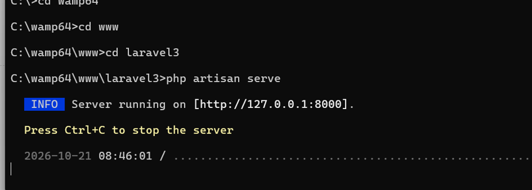

### Página inicial

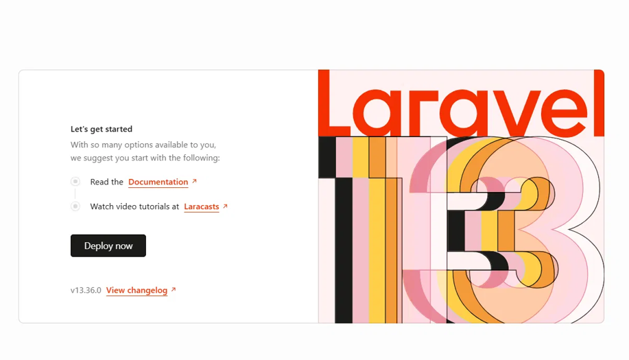

### Registro

El formulario solicita nombre, correo electrónico y contraseña. Las capturas con datos ingresados se protegieron antes de incluirse aquí.

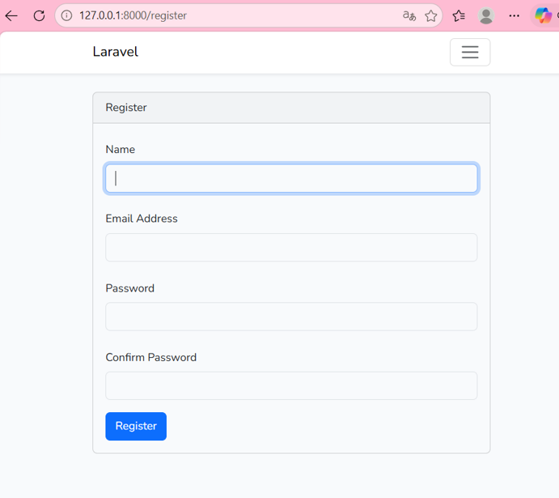

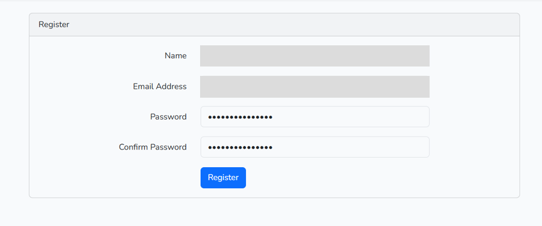

### Panel de usuario

La ruta `/home` muestra el panel después de iniciar sesión.

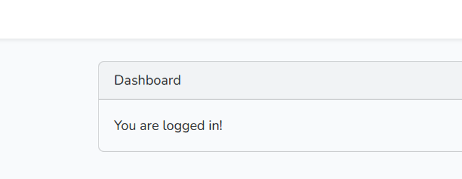

---

## 5. ⚙️ Instalación y ejecución

### 5.1 Clonar el repositorio

```powershell
git clone https://github.com/hlemerix/laravel-lab.git
cd laravel-lab
```

### 5.2 Instalar y preparar la aplicación

```powershell
composer run setup
```

El comando instala las dependencias de PHP, crea `.env` desde `.env.example` si hace falta, genera la clave de la aplicación, ejecuta las migraciones e instala y compila los recursos frontend.

### 5.3 Iniciar el entorno de desarrollo

```powershell
composer run dev
```

También puedes iniciar el servidor de Laravel y Vite por separado, cada uno en su propia terminal:

```powershell
php artisan serve
```

```powershell
npm run dev
```

Después, abre `http://127.0.0.1:8000` en el navegador.

### Rutas principales

| Ruta | Función |
|---|---|
| `/` | Página de bienvenida |
| `/register` | Registro de usuario |
| `/login` | Inicio de sesión |
| `/password/reset` | Solicitud de restablecimiento de contraseña |
| `/home` | Panel protegido; requiere iniciar sesión |

---

## 6. 🗄️ Base de datos

### Configuración

La plantilla `.env.example` está preparada para SQLite. Si eliges MySQL, crea primero una base de datos vacía y configura las variables `DB_CONNECTION`, `DB_HOST`, `DB_PORT`, `DB_DATABASE`, `DB_USERNAME` y `DB_PASSWORD` en tu archivo `.env`.

Después de modificar la configuración del entorno, limpia la caché y ejecuta las migraciones:

```powershell
php artisan config:clear
php artisan migrate
```

> No publiques ni compartas `.env`: puede contener la clave de la aplicación y credenciales. Utiliza `.env.example` como plantilla y reemplaza cualquier dato de ejemplo por valores locales.

### Migraciones incluidas

El proyecto contiene migraciones para usuarios, sesiones, caché, trabajos en cola y la tabla `productos`. La migración de productos crea actualmente el identificador y las marcas de tiempo; el módulo CRUD de productos todavía no está implementado.

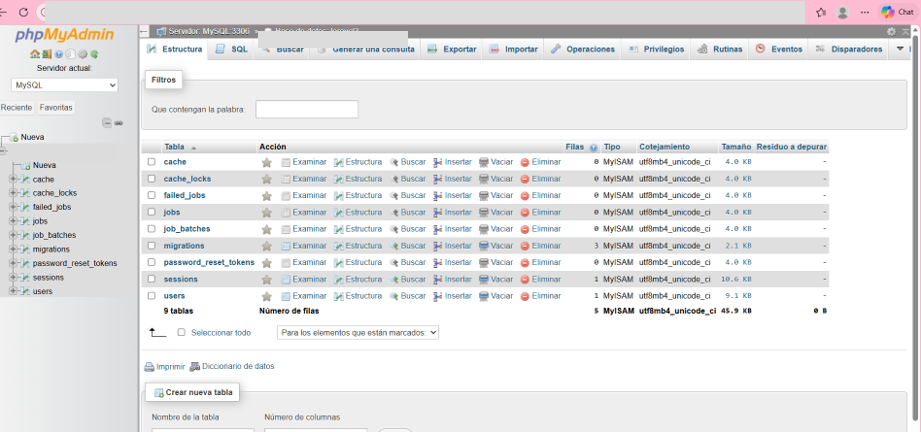

Para borrar y volver a crear todas las tablas de la base configurada existe:

```powershell
php artisan migrate:fresh
```

> **Precaución:** `migrate:fresh` elimina todas las tablas de esa base de datos. No lo ejecutes en una base con información que necesites conservar.

---

## 7. 🎛️ Funcionalidades y controles

| Funcionalidad | Descripción |
|---|---|
| **Registro** | Crea una cuenta con nombre, correo y contraseña. |
| **Inicio y cierre de sesión** | Gestiona el acceso a la aplicación. |
| **Restablecimiento de contraseña** | Incluye las rutas y vistas de recuperación de contraseña de Laravel UI. |
| **Panel protegido** | `/home` requiere autenticación. |
| **Recursos frontend** | Vite compila los estilos y recursos JavaScript. |
| **Productos** | Hay modelo, controlador y migración iniciales; las operaciones CRUD están pendientes. |

La autenticación de las vistas se genera con Laravel UI y las plantillas Blade correspondientes.

---

## 8. 🗂️ Estructura del proyecto y MVC

```text
laravel-lab/
├── app/
│   ├── Http/Controllers/     # Controladores web y de autenticación
│   └── Models/               # Modelos User y Producto
├── database/
│   └── migrations/           # Estructura de las tablas
├── docs/
│   └── img/                  # Capturas de pantalla protegidas
├── resources/
│   ├── js/                   # Recursos JavaScript
│   ├── sass/                 # Estilos
│   └── views/                # Vistas Blade
├── routes/
│   └── web.php               # Rutas web y autenticación
├── .env.example              # Plantilla de configuración local
├── composer.json
└── package.json
```

---

## 9. ✅ Evidencias de migraciones y registros

La captura de la terminal muestra las migraciones ejecutadas, incluida la migración inicial de productos.

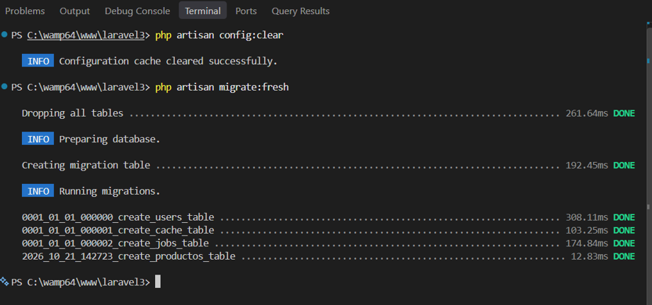

La captura de la tabla de usuarios oculta nombres, correos y hashes de contraseña. No se incluyen contraseñas ni identificadores de sesión en las evidencias.

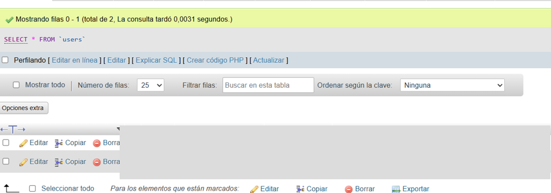

---

## 10. 🛠️ Dificultades y soluciones

### Dificultad 1: Composer no se reconocía como comando

Al intentar instalar Laravel desde el símbolo del sistema, Windows indicó que `composer` no se reconocía como comando interno o externo.

**Solución:** instalar Composer para Windows y comprobar que su ubicación esté agregada al `PATH`. Después, abrir una terminal nueva y verificar la instalación con `composer --version`.

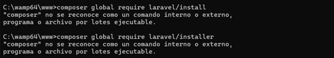

### Dificultad 2: Permiso denegado al guardar una dependencia

Durante la descarga del proyecto, Composer no pudo escribir el archivo del paquete en su carpeta temporal y mostró `Permission denied`.

**Solución:** comprobar que la cuenta de Windows tenga permisos de escritura en la carpeta temporal y en el proyecto, cerrar procesos que puedan bloquear esos archivos y volver a intentar la instalación. Para este proyecto se continuó con la creación de la aplicación mediante Laravel Installer y luego se ejecutó su flujo de preparación.

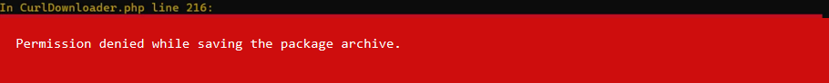

### Dificultad 3: No existía la tabla de sesiones

Al abrir la aplicación apareció una excepción de base de datos porque no se había creado la tabla `sessions`, necesaria cuando la aplicación utiliza sesiones almacenadas en la base de datos.

**Solución:** ejecutar `php artisan migrate` para crear las tablas pendientes. Si el esquema local quedó incompleto y se puede borrar toda la información de esa base de desarrollo, se puede usar `php artisan migrate:fresh`; este comando elimina todas las tablas antes de volver a crearlas.

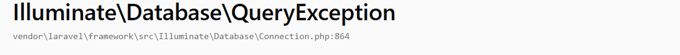

---

## 11. 📚 Referencias

1. Laravel. [Documentación oficial](https://laravel.com/docs).
2. Laravel. [Instalación](https://laravel.com/docs/installation).
3. Laravel. [Migraciones](https://laravel.com/docs/migrations).
4. Laravel UI. [Repositorio oficial](https://github.com/laravel/ui).
5. Composer. [Documentación](https://getcomposer.org/doc/).
6. Vite. [Guía oficial](https://vite.dev/guide/).
7. Bootstrap. [Documentación](https://getbootstrap.com/docs/).
8. MySQL. [The InnoDB Storage Engine](https://dev.mysql.com/doc/refman/8.4/en/innodb-storage-engine.html).

---

## 12. 📅 Fecha de ejecución e información del estudiante

El laboratorio se realizó el **22 de octubre de 2026**.

<div align="center">

### 🎓 Información del estudiante

Este laboratorio fue desarrollado por:

**Nombre:** Hanna Licona<br>
**Curso:** Desarrollo Web<br>
**Instructor del laboratorio:** Ing. Irina Fong

</div>

---

<div align="center">

**Repositorio:** [github.com/hlemerix/laravel-lab](https://github.com/hlemerix/laravel-lab)

</div>
